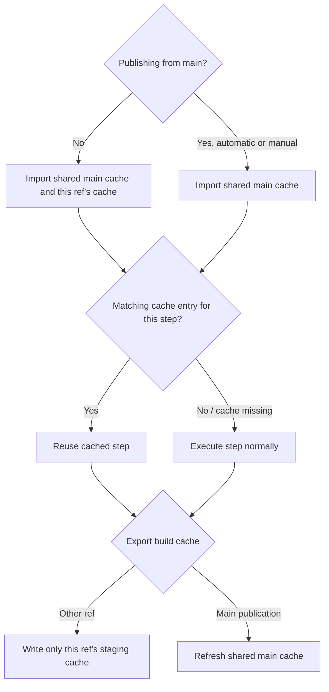

# ci-imgs

This repository includes the following CI images for RAPIDS:

- [`rapidsai/ci-conda`](https://hub.docker.com/r/rapidsai/ci-conda/tags): for building and testing RAPIDS `conda` packages
- [`rapidsai/ci-wheel`](https://hub.docker.com/r/rapidsai/ci-wheel/tags): for building and publishing RAPIDS wheels (including pure-Python and manylinux-compliant wheels)
- [`rapidsai/citestwheel`](https://hub.docker.com/r/rapidsai/citestwheel/tags): for testing wheels

The `ci-wheel` and `citestwheel` images include a standalone `uv` in `/usr/local/bin`,
with its version pinned in `versions.yaml`. Existing Python tooling continues to be
installed using pip; downstream jobs explicitly opt in to uv.

## Tagging Strategy

Images built from the `main` branch in CI are double-published with the following tags:

```text
:{rapids_version}-cuda{cuda_version}-{operating_system}-py{python_version}
:cuda{cuda_version}-{operating_system}-py{python_version}
```

Images built from other branches (including release branches), pull requests, or locally only receive the versioned tag (with `{rapids_version}-`).

One particular combination is also chosen for `latest` tags like these:

```text
:{rapids_version}-latest
:latest
```

For example, during the 25.10 release the following might all point to the same image:

```text
rapidsai/ci-conda:25.10-cuda13.1.0-ubuntu24.04-py3.13
rapidsai/ci-conda:cuda13.1.0-ubuntu24.04-py3.13
rapidsai/ci-conda:25.10-latest
rapidsai/ci-conda:latest
```

But starting with the 25.12 release...

```text
# these images are unchanged
rapidsai/ci-conda:25.10-cuda13.1.0-ubuntu24.04-py3.13
rapidsai/ci-conda:25.10-latest

# these now point to 25.12
rapidsai/ci-conda:cuda13.1.0-ubuntu24.04-py3.13
rapidsai/ci-conda:latest
```

RAPIDS projects and others tightly coupled to RAPIDS releases should use the images prefixed with `{rapids_version}-`.

Other projects that aren't as tightly coupled to RAPIDS may want to use those without `{rapids_version}-`, to automatically
pull in bug fixes, new features, etc. without needing to manually update tags as frequently as RAPIDS releases.

## `latest` tag

The `latest` image tags are controlled by the values in `latest.yaml`.

## Building the images locally

To build the images locally, you may use the following snippets.

These scripts require the `gha-tools` project.
If you don't have it installed, you may install it like this:

```shell
git clone https://github.com/rapidsai/gha-tools.git /tmp/gha-tools
export PATH="/tmp/gha-tools/tools:${PATH}"
```

The `ci-conda` and `ci-wheel` images require a GitHub token to download sccache releases.
If you have the `gh` CLI installed and authenticated, you can use `gh auth token` to get your token:

```sh
export LINUX_VER=rockylinux8
export CUDA_VER=13.4.3
export PYTHON_VER=3.14
export ARCH=amd64
export GH_TOKEN=$(gh auth token)

export IMAGE_REPO=ci-conda
docker build $(ci/compute-build-args.sh) --secret id=GH_TOKEN -f ci-conda.Dockerfile -t rapidsai/${IMAGE_REPO}:local context/

export IMAGE_REPO=ci-wheel
./ci/sync-base-env.sh "nvidia/cuda:${CUDA_VER}-devel-${LINUX_VER}" ./ci-wheel.Dockerfile
docker build $(ci/compute-build-args.sh) --secret id=GH_TOKEN -f ci-wheel.Dockerfile -t rapidsai/${IMAGE_REPO}:local context/

export IMAGE_REPO=citestwheel
docker build $(ci/compute-build-args.sh) -f citestwheel.Dockerfile -t rapidsai/${IMAGE_REPO}:local context/
```

## Build cache

CI stores a registry-backed BuildKit cache for each image variant and architecture.
Publications from `main`, including manually triggered publications, read and
refresh the shared cache, for example:
`rapidsai/ci-wheel:cuda13.4.3-rockylinux8-py3.14-buildcache-arm64`.
These names omit the RAPIDS release version so a release-number update can reuse
the existing build layers.

Every other ref reads the shared main cache and its own scoped cache, but writes
only to its scoped staging tag:
`rapidsai/staging:ci-wheel-ref-{ref_hash}-cuda13.4.3-rockylinux8-py3.14-buildcache-arm64`.
The `{ref_hash}` is the first 32 hexadecimal characters of the SHA-256 of
`{repository}:{full_ref}`. It keeps tag names valid and distinct even when ref
names contain slashes or punctuation. PR builds use their existing
`refs/heads/pull-request/<number>` refs, so they use this same mechanism rather
than an additional PR cache. Manual publications from release or feature branches
also use scoped caches and cannot refresh the main cache.
Each build exports intermediate-stage layers (`mode=max`) so subsequent builds on
fresh runners can reuse them. A missing cache leaves the build to populate it.

The cache lookup happens for each build step. For non-main builds, BuildKit considers
both imported caches and can reuse matching steps from either. If neither has a
matching entry, that step runs normally. See Docker's
[multiple-cache documentation](https://docs.docker.com/build/cache/backends/#multiple-caches).



This does not change the image contents or the installation of `gha-tools`.

## Cleaning Up

Every build first writes images to the https://hub.docker.com/r/rapidsai/staging repo on DockerHub,
then pushes them on to the individual repos like `rapidsai/base`, `rapidsai/notebooks`, etc.

A scheduled job regularly deletes old images from that `rapidsai/staging` repo.
See https://github.com/rapidsai/workflows/blob/main/.github/workflows/cleanup_staging.yaml for details.

If you come back to a pull request here after more than a few days and find that jobs are failing with errors
that suggest that some necessary images don't exist, re-run all of CI on that pull request to produce new images.
